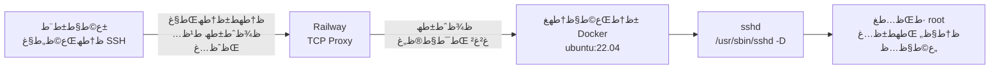

<div align="center">

# ًںگ§ Ubuntu SSH Server — Railway Edition

### ط³ط±ظˆط± ط§ظˆط¨ظˆظ†طھظˆ ط±ظˆغŒ Railway ط¨ط§ ط¯ط³طھط±ط³غŒ ع©ط§ظ…ظ„ SSH — ط¨ط¯ظˆظ† GUI

<p>
  
  
  
  
  
</p>

<p>
  <a href="https://github.com/hajihshmat/docker-ubuntu-free">
    
  </a>
  <a href="https://railway.app">
    
  </a>
</p>

</div>

---

> ## âڑ ï¸ڈ ظ‡ط´ط¯ط§ط± ط§ظ…ظ†غŒطھغŒ — ط§غŒظ† ط¨ط®ط´ ط±ط§ ظ‚ط¨ظ„ ط§ط² ظ‡ط± ع†غŒط² ط¨ط®ظˆط§ظ†غŒط¯
>
> ط±ظ…ط² ط¹ط¨ظˆط± ظ¾غŒط´â€Œظپط±ط¶ ع©ط§ط±ط¨ط± `root` ط¨ظ‡â€Œطµظˆط±طھ **ظ…طھظ† ط³ط§ط¯ظ‡** ط¯ط§ط®ظ„ ظپط§غŒظ„ `entrypoint.sh` ظ†ظˆط´طھظ‡ ط´ط¯ظ‡ ط§ط³طھ ظˆ ط¯ط± ظ‡ظ…غŒظ† ظ…ط®ط²ظ† ط¹ظ…ظˆظ…غŒ ظ‚ط§ط¨ظ„ ظ…ط´ط§ظ‡ط¯ظ‡ ط§ط³طھ. غŒط¹ظ†غŒ ظ‡ط± ع©ط³غŒ ع©ظ‡ ط§غŒظ† ظ…ط®ط²ظ† ط±ط§ ط¨ط¨غŒظ†ط¯طŒ ظ…غŒâ€Œطھظˆط§ظ†ط¯ ط¨ظ‡ ط³ط±ظˆط± ط¯ط± ط­ط§ظ„ ط§ط¬ط±ط§غŒ ط´ظ…ط§ ظˆطµظ„ ط´ظˆط¯.
>
> **ط¨ط¹ط¯ ط§ط² ط§ظˆظ„غŒظ† ظˆط±ظˆط¯طŒ ط¨ظ„ط§ظپط§طµظ„ظ‡ ط±ظ…ط² ط¹ط¨ظˆط± ط±ط§ طھط؛غŒغŒط± ط¯ظ‡غŒط¯:**
>
> ```bash
> passwd root
> ```
>
> ظˆ غŒع© ط±ظ…ط² ظ‚ظˆغŒ ظˆ غŒع©طھط§ ط§ظ†طھط®ط§ط¨ ع©ظ†غŒط¯. طھط§ ط²ظ…ط§ظ†غŒ ع©ظ‡ ط§غŒظ† ع©ط§ط± ط±ط§ ظ†ع©ط±ط¯ظ‡â€Œط§غŒط¯طŒ ط³ط±ظˆط± ط´ظ…ط§ ط¯ط± ظ…ط¹ط±ط¶ ط®ط·ط± ط§ط³طھ.
>
> ط¨ط±ط§غŒ طھط؛غŒغŒط± ط¯ط§ط¦ظ…غŒ ط±ظ…ط² (ع©ظ‡ ط¨ط¹ط¯ ط§ط² ظ‡ط± Deploy ط¨ط§ظ‚غŒ ط¨ظ…ط§ظ†ط¯) ط¨ط®ط´ [طھط؛غŒغŒط± ط±ظ…ط² ط¹ط¨ظˆط±](#-طھط؛غŒغŒط±-ط±ظ…ط²-ط¹ط¨ظˆط±-ظ…ظ‡ظ…) ط±ط§ ط¨ط¨غŒظ†غŒط¯.

---

## ًں“– ظ…ط¹ط±ظپغŒ ظ¾ط±ظˆعکظ‡

ط§غŒظ† ظ¾ط±ظˆعکظ‡ غŒع© **ط³ط±ظˆط± ط§ظˆط¨ظˆظ†طھظˆ ط¨ط§ ط¯ط³طھط±ط³غŒ ع©ط§ظ…ظ„ SSH** ط±ظˆغŒ ظ¾ظ„طھظپط±ظ… [Railway](https://railway.app) ط±ط§ظ‡â€Œط§ظ†ط¯ط§ط²غŒ ظ…غŒâ€Œع©ظ†ط¯. ع©ط§ظپغŒ ط§ط³طھ ظ…ط®ط²ظ† ط±ط§ Fork ع©ظ†غŒط¯ ظˆ ط±ظˆغŒ Railway ظ…ط³طھظ‚ط± ع©ظ†غŒط¯ — ط¯ط± ع†ظ†ط¯ ط¯ظ‚غŒظ‚ظ‡ غŒع© ط³ط±ظˆط± ظ„غŒظ†ظˆع©ط³ ظˆط§ظ‚ط¹غŒ ط¨ط§ ط¯ط³طھط±ط³غŒ root ط¯ط± ط§ط®طھغŒط§ط± ط¯ط§ط±غŒط¯.

ط¨ط±ط®ظ„ط§ظپ ظ†ط³ط®ظ‡â€Œظ‡ط§غŒ ظ…ط´ط§ط¨ظ‡طŒ ط§غŒظ† ظ¾ط±ظˆعکظ‡ **ظ‡غŒع† ظ…ط­غŒط· ع¯ط±ط§ظپغŒع©غŒ (GUI) ظ†ط¯ط§ط±ط¯** ظˆ ط¹ظ…ط¯ط§ظ‹ ط³ط¨ع© ظ†ع¯ظ‡ ط¯ط§ط´طھظ‡ ط´ط¯ظ‡ ط§ط³طھ: ظپظ‚ط· `openssh-server` ظˆ ع†ظ†ط¯ ط§ط¨ط²ط§ط± ط¶ط±ظˆط±غŒ. ط¯ط± ظ†طھغŒط¬ظ‡ ط³ط±غŒط¹ Build ظ…غŒâ€Œط´ظˆط¯طŒ ظ…ظ†ط§ط¨ط¹ ع©ظ…طھط±غŒ ظ…طµط±ظپ ظ…غŒâ€Œع©ظ†ط¯ ظˆ ط±ظˆغŒ ظ¾ظ„ظ† ط±ط§غŒع¯ط§ظ† Railway ط±ط§ط­طھ ط§ط¬ط±ط§ ظ…غŒâ€Œط´ظˆط¯.

### ط§غŒظ† ظ¾ط±ظˆعکظ‡ ع†ظ‡ ع†غŒط²غŒ ظ‡ط³طھ ظˆ ع†ظ‡ ع†غŒط²غŒ ظ†غŒط³طھ

| ✅ ظ‡ط³طھ | â‌Œ ظ†غŒط³طھ |
|:---|:---|
| ط³ط±ظˆط± Ubuntu 22.04 ط¨ط§ ط¯ط³طھط±ط³غŒ root | ط¯ط³ع©طھط§ظ¾ ع¯ط±ط§ظپغŒع©غŒ غŒط§ ظ…ط­غŒط· XFCE |
| ط¯ط³طھط±ط³غŒ SSH ط§ط² ط·ط±غŒظ‚ طھط±ظ…غŒظ†ط§ظ„ | ط¯ط³طھط±ط³غŒ VNC غŒط§ noVNC ط§ط² ظ…ط±ظˆط±ع¯ط± |
| ظ…ط­غŒط· CLI ع©ط§ظ…ظ„ ط¨ط§ `git`, `vim`, `curl`, `wget` | ظ…ط­غŒط· ع©ط§ط±ط¨ط±غŒ ع¯ط±ط§ظپغŒع©غŒ ط¨ط±ط§غŒ ع©ط§ط±ظ‡ط§غŒ طھطµظˆغŒط±غŒ |
| ظ…ظ†ط§ط³ط¨ ط§ط¬ط±ط§غŒ ط§ط³ع©ط±غŒظ¾طھطŒ ط¨غŒظ„ط¯طŒ ط¢ظ…ظˆط²ط´ ظ„غŒظ†ظˆع©ط³ | ط¬ط§غŒع¯ط²غŒظ† ط³ط±ظˆط± Production |

---

## ًں™ڈ ط§ط¹طھط¨ط§ط± ظˆ ظ…ظ†ط¨ط¹ ط§ظ„ظ‡ط§ظ…

ط§غŒظ† ظ¾ط±ظˆعکظ‡ ط§ط² ظ…ط®ط²ظ† [**technamooz/docker-ubuntu-free**](https://github.com/technamooz/docker-ubuntu-free) ط§ظ„ظ‡ط§ظ… ع¯ط±ظپطھظ‡ ط´ط¯ظ‡ ط§ط³طھ. ط§غŒط¯ظ‡ظ” ط§ظˆظ„غŒظ‡ — ط±ط§ظ‡â€Œط§ظ†ط¯ط§ط²غŒ غŒع© ط³ط±ظˆط± Ubuntu ط±ط§غŒع¯ط§ظ† ط±ظˆغŒ Railway — ط§ط² ط¢ظ† ظ¾ط±ظˆعکظ‡ ط¢ظ…ط¯ظ‡ ط§ط³طھ.

**طھظپط§ظˆطھ ط§طµظ„غŒ:** ط¢ظ† ظ¾ط±ظˆعکظ‡ غŒع© ط³ط±ظˆط± ط¨ط§ **ظ…ط­غŒط· ع¯ط±ط§ظپغŒع©غŒ (GUI) ظˆ ط¯ط³طھط±ط³غŒ VNC ط§ط² ظ…ط±ظˆط±ع¯ط±** ط§ط±ط§ط¦ظ‡ ظ…غŒâ€Œط¯ظ‡ط¯طŒ ط¯ط± ط­ط§ظ„غŒ ع©ظ‡ ط§غŒظ† ظ†ط³ط®ظ‡ غŒع© ط³ط±ظˆط± **ظپظ‚ط· ط¨ط§ SSH** ط§ط³طھ. ط¯ظ„غŒظ„ ط§غŒظ† طھط؛غŒغŒط±:

- ط³ط¨ع©â€Œطھط± ط¨ظˆط¯ظ† image ظˆ Build ط³ط±غŒط¹â€Œطھط±
- ظ…طµط±ظپ ظ…ظ†ط§ط¨ط¹ ع©ظ…طھط± (ظ…ظ†ط§ط³ط¨ ط¨ط±ط§غŒ ظ¾ظ„ظ† ط±ط§غŒع¯ط§ظ†)
- ط¯ط³طھط±ط³غŒ SSH ظ¾ط§غŒط¯ط§ط±طھط± ظˆ ط§ظ…ظ†â€Œطھط± ط§ط² غŒع© ط¯ط³ع©طھط§ظ¾ ع¯ط±ط§ظپغŒع©غŒ ط±ظˆغŒ ع©ط§ظ†طھغŒظ†ط± ط§ط³طھ
- ط¨ط±ط§غŒ ع©ط§ط±ظ‡ط§غŒ ظˆط§ظ‚ط¹غŒ ط³ط±ظˆط±طŒ طھط±ظ…غŒظ†ط§ظ„ ع©ط§ظپغŒ ط§ط³طھ

ظپط§غŒظ„ `LICENSE` ط§غŒظ† ظ¾ط±ظˆعکظ‡ ط·ط¨ظ‚ ط´ط±ط· ظ…ط¬ظˆط² MITطŒ ط­ظ‚ ظ†ط´ط± ط§طµظ„غŒ (technamooz) ط±ط§ ط­ظپط¸ ع©ط±ط¯ظ‡ ط§ط³طھ.

---

## ✨ ظˆغŒعکع¯غŒâ€Œظ‡ط§

| ظˆغŒعکع¯غŒ | طھظˆط¶غŒط­ |
|:---:|:---|
| ًں’» ط¯ط³طھط±ط³غŒ ع©ط§ظ…ظ„ SSH | ظˆط±ظˆط¯ ط¨ط§ ع©ط§ط±ط¨ط± `root` ظˆ ط±ظ…ط² ط¹ط¨ظˆط±طŒ ط¨ط¯ظˆظ† ظ†غŒط§ط² ط¨ظ‡ طھظ†ط¸غŒظ… ع©ظ„غŒط¯ |
| ًںھ¶ ط³ط¨ع© ظˆ ط³ط±غŒط¹ | ظپظ‚ط· `openssh-server` ظˆ ط§ط¨ط²ط§ط±ظ‡ط§غŒ ط¶ط±ظˆط±غŒ — Build ط²غŒط± ع†ظ†ط¯ ط¯ظ‚غŒظ‚ظ‡ |
| âڑ، ط±ط§ظ‡â€Œط§ظ†ط¯ط§ط²غŒ ط³ط±غŒط¹ | ع©ظ„ ظپط±ط¢غŒظ†ط¯ ظ†طµط¨ ع©ظ…طھط± ط§ط² غ±غ° ط¯ظ‚غŒظ‚ظ‡ |
| ًں”§ ط§ط¨ط²ط§ط±ظ‡ط§غŒ ط¢ظ…ط§ط¯ظ‡ | `git`, `vim`, `curl`, `wget`, `net-tools`, `sudo`, `tzdata` |
| ًںŒچ ط¯ط³طھط±ط³غŒ ط¬ظ‡ط§ظ†غŒ | ط§ط² ظ‡ط± ط¬ط§غŒ ط¯ظ†غŒط§طŒ ط¨ط§ ظ‡ط± ع©ظ„ط§غŒظ†طھغŒ ع©ظ‡ SSH ط¯ط§ط±ط¯ |
| ًںگ³ ظ…ط¨طھظ†غŒ ط¨ط± Docker | طھطµظˆغŒط± ط´ظپط§ظپ ظˆ ظ‚ط§ط¨ظ„ ط¨ط§ط²طھظˆظ„غŒط¯ ط¨ط± ظ¾ط§غŒظ‡ `ubuntu:22.04` |
| ًںھں ط³ط§ط²ع¯ط§ط± ط¨ط§ ظˆغŒظ†ط¯ظˆط² | ط§ط³ع©ط±غŒظ¾طھ ظˆط±ظˆط¯غŒ ظ…ط´ع©ظ„ CRLF ط±ط§ ط®ظˆط¯ط´ ط­ظ„ ظ…غŒâ€Œع©ظ†ط¯ |

---

## ًں“‹ ظ¾غŒط´â€Œظ†غŒط§ط²ظ‡ط§

| ظ…ظˆط±ط¯ ظ†غŒط§ط² | ظ„غŒظ†ع© |
|:---|:---:|
| ط­ط³ط§ط¨ ع©ط§ط±ط¨ط±غŒ GitHub | [github.com](https://github.com) |
| ط­ط³ط§ط¨ ع©ط§ط±ط¨ط±غŒ Railway | [railway.app](https://railway.app) |
| غŒع© ع©ظ„ط§غŒظ†طھ SSH | طھط±ظ…غŒظ†ط§ظ„ ظ„غŒظ†ظˆع©ط³/ظ…ع©طŒ غŒط§ PowerShell ظˆ CMD ط¯ط± ظˆغŒظ†ط¯ظˆط² |

> **ط¯ط± ظˆغŒظ†ط¯ظˆط²** ظ†غŒط§ط²غŒ ط¨ظ‡ ظ†طµط¨ ظ†ط±ظ…‌ط§ظپط²ط§ط± ط¬ط¯ط§ع¯ط§ظ†ظ‡ ظ†غŒط³طھ — `ssh` ط§ط² ظˆغŒظ†ط¯ظˆط² غ±غ° ط¨ظ‡ ط¨ط¹ط¯ ط¨ظ‡â€Œطµظˆط±طھ ظ¾غŒط´â€Œظپط±ط¶ ظ†طµط¨ ط§ط³طھ. ط¨ط±ط§غŒ طھط³طھ ط¯ط± PowerShell ط¨ظ†ظˆغŒط³غŒط¯ `ssh -V`.

---

## ًںڈ—ï¸ڈ ظ…ط¹ظ…ط§ط±غŒ



ع©ط§ظ†طھغŒظ†ط± ظپظ‚ط· `sshd` ط±ط§ ط§ط¬ط±ط§ ظ…غŒâ€Œع©ظ†ط¯. ظ‡غŒع† ط³ط±ظˆغŒط³ ط¯غŒع¯ط±غŒ ط±ظˆغŒ ط¢ظ† ط§ط¬ط±ط§ ظ†ظ…غŒâ€Œط´ظˆط¯ ظˆ ظ‡غŒع† ظ¾ظˆط±طھغŒ ط¨ظ‡â€Œط¬ط² غ²غ² ط¯ط± ط¯ط³طھط±ط³ ظ†غŒط³طھ.

---

## ًںڑ€ ط¢ظ…ظˆط²ط´ ظ†طµط¨ ظˆ ط±ط§ظ‡â€Œط§ظ†ط¯ط§ط²غŒطŒ ظ‚ط¯ظ… ط¨ظ‡ ظ‚ط¯ظ…

<table>
<tr><th>ظ…ط±ط­ظ„ظ‡</th><th>ط¹ظ…ظ„غŒط§طھ</th></tr>

<tr>
<td><b>غ±</b></td>
<td>غŒع© ط­ط³ط§ط¨ ع©ط§ط±ط¨ط±غŒ ط¯ط± <a href="https://github.com">GitHub</a> ط¨ط³ط§ط²غŒط¯ (ط§ع¯ط± ظ†ط¯ط§ط±غŒط¯).</td>
</tr>

<tr>
<td><b>غ²</b></td>
<td>ظ…ط®ط²ظ† <a href="https://github.com/hajihshmat/docker-ubuntu-free"><code>docker-ubuntu-free</code></a> ط±ط§ ط¨ط§ ط¯ع©ظ…ظ‡ <b>Fork</b> ط¯ط± ط­ط³ط§ط¨ ط®ظˆط¯طھط§ظ† ع©ظ¾غŒ ع©ظ†غŒط¯.</td>
</tr>

<tr>
<td><b>غ³</b></td>
<td>ظˆط§ط±ط¯ <a href="https://railway.app">Railway</a> ط´ظˆغŒط¯ ظˆ ط¨ط§ ع¯ط²غŒظ†ظ‡ <b>Sign in with GitHub</b> ظˆط§ط±ط¯ ط´ظˆغŒط¯.</td>
</tr>

<tr>
<td><b>غ´</b></td>
<td>ط±ظˆغŒ <b>New Project</b> ع©ظ„غŒع© ع©ظ†غŒط¯ → ع¯ط²غŒظ†ظ‡ <b>Deploy from GitHub repo</b> ط±ط§ ط§ظ†طھط®ط§ط¨ ع©ظ†غŒط¯ → ظ…ط®ط²ظ† ظپظˆط±ع©â€Œط´ط¯ظ‡ (<code>docker-ubuntu-free</code>) ط±ط§ ط§ظ†طھط®ط§ط¨ ع©ظ†غŒط¯.</td>
</tr>

<tr>
<td><b>غµ</b></td>
<td>Railway ط®ظˆط¯ط´ ظپط§غŒظ„ <code>Dockerfile</code> ط±ط§ طھط´ط®غŒطµ ظ…غŒâ€Œط¯ظ‡ط¯ ظˆ ط´ط±ظˆط¹ ط¨ظ‡ Build ظ…غŒâ€Œع©ظ†ط¯. طµط¨ط± ع©ظ†غŒط¯ طھط§ ظˆط¶ط¹غŒطھ ط¨ظ‡ <b>Online</b> طھط؛غŒغŒط± ع©ظ†ط¯. (ع†ظ†ط¯ ط¯ظ‚غŒظ‚ظ‡ ط·ظˆظ„ ظ…غŒâ€Œع©ط´ط¯)</td>
</tr>

<tr>
<td><b>غ¶</b></td>
<td>
ظˆط§ط±ط¯ طھط¨ <b>Settings</b> ظ¾ط±ظˆعکظ‡ ط´ظˆغŒط¯ → ط¨ط®ط´ <b>Networking</b> → ع¯ط²غŒظ†ظ‡ <b>TCP Proxy</b> ط±ط§ ظپط¹ط§ظ„ ع©ظ†غŒط¯ ظˆ <b>ظ¾ظˆط±طھ ط¯ط§ط®ظ„غŒ ط±ط§ <code>22</code></b> ط¨ع¯ط°ط§ط±غŒط¯.
</td>
</tr>

<tr>
<td><b>غ·</b></td>
<td>
Railway غŒع© ط¢ط¯ط±ط³ ط¹ظ…ظˆظ…غŒ ط¨ظ‡ ط´ظ…ط§ ظ…غŒâ€Œط¯ظ‡ط¯ ع©ظ‡ ط´ع©ظ„ ط¢ظ† ع†غŒط²غŒ ط´ط¨غŒظ‡ ط§غŒظ† ط§ط³طھ:
<br/>
<code>roundhouse.proxy.rlwy.net:34567</code>
<br/>
ط§غŒظ† <b>ط¢ط¯ط±ط³</b> ظˆ <b>ظ¾ظˆط±طھ ط¹ظ…ظˆظ…غŒ</b> ط±ط§ ع©ظ¾غŒ ع©ظ†غŒط¯ — ط¨ط±ط§غŒ ط§طھطµط§ظ„ SSH ظ„ط§ط²ظ… ط¯ط§ط±غŒط¯.
</td>
</tr>

</table>

> **ظ†ع©طھظ‡:** ظ¾ظˆط±طھ ط¹ظ…ظˆظ…غŒ ع©ظ‡ Railway ظ…غŒâ€Œط¯ظ‡ط¯ ط¨ط§ ظ¾ظˆط±طھ ط¯ط§ط®ظ„غŒ (غ²غ²) غŒع©غŒ ظ†غŒط³طھ ظˆ ظ…ظ…ع©ظ† ط§ط³طھ طھط؛غŒغŒط± ع©ظ†ط¯. ظ‡ظ…غŒط´ظ‡ ط¢ط¯ط±ط³ ظپط¹ظ„غŒ ط±ط§ ط§ط² طھط¨ Networking ط¨ط±ط¯ط§ط±غŒط¯.

---

## ًں”Œ ط§طھطµط§ظ„ ط¨ظ‡ ط³ط±ظˆط±

### ظ„غŒظ†ظˆع©ط³ / ظ…ع© / Git Bash

```bash
ssh root@roundhouse.proxy.rlwy.net -p 34567
```

### ظˆغŒظ†ط¯ظˆط² (PowerShell غŒط§ CMD)

```powershell
ssh root@roundhouse.proxy.rlwy.net -p 34567
```

`roundhouse.proxy.rlwy.net` ظˆ `34567` ط±ط§ ط¨ط§ ط¢ط¯ط±ط³ ظˆ ظ¾ظˆط±طھ ظˆط§ظ‚ط¹غŒ ط®ظˆط¯طھط§ظ† ط¹ظˆط¶ ع©ظ†غŒط¯.

**ط¯ط± ط§ظˆظ„غŒظ† ط§طھطµط§ظ„** ظ¾غŒط§ظ…غŒ ظ…ط´ط§ط¨ظ‡ ط§غŒظ† ظ…غŒâ€Œط¨غŒظ†غŒط¯:

```
The authenticity of host '[roundhouse.proxy.rlwy.net]:34567' can't be established.
ED25519 key fingerprint is SHA256:xxxxxxxxxxxxxxxxxxxxxxxxxxx.
Are you sure you want to continue connecting (yes/no/[fingerprint])?
```

ط¹ط¨ط§ط±طھ `yes` ط±ط§ طھط§غŒظ¾ ع©ظ†غŒط¯ ظˆ Enter ط¨ط²ظ†غŒط¯. ط³ظ¾ط³ ط±ظ…ط² ط¹ط¨ظˆط± ط±ط§ ظˆط§ط±ط¯ ع©ظ†غŒط¯:

```
root@roundhouse.proxy.rlwy.net's password:
```

ط±ظ…ط² ط¹ط¨ظˆط± ظ¾غŒط´â€Œظپط±ط¶: `Root@123456`

ط§ع¯ط± ظˆط±ظˆط¯ ظ…ظˆظپظ‚ ط¨ط§ط´ط¯طŒ prompt ط³ط±ظˆط± ط±ط§ ظ…غŒâ€Œط¨غŒظ†غŒط¯:

```
root@a1b2c3d4e5f6:~#
```

ط§ع©ظ†ظˆظ† غŒع© ط³ط±ظˆط± ط§ظˆط¨ظˆظ†طھظˆ ع©ط§ظ…ظ„ ط¯ط± ط§ط®طھغŒط§ط± ط¯ط§ط±غŒط¯. ًںژ‰

---

## ًں”‘ طھط؛غŒغŒط± ط±ظ…ط² ط¹ط¨ظˆط± (ظ…ظ‡ظ…)

**ط§غŒظ† ع©ط§ط± ط±ط§ ط¨ظ„ط§ظپط§طµظ„ظ‡ ط¨ط¹ط¯ ط§ط² ط§ظˆظ„غŒظ† ظˆط±ظˆط¯ ط§ظ†ط¬ط§ظ… ط¯ظ‡غŒط¯.** ط±ظ…ط² ظ¾غŒط´â€Œظپط±ط¶ ط¯ط± ظ…ط®ط²ظ† ط¹ظ…ظˆظ…غŒ ظ‚ط§ط¨ظ„ ظ…ط´ط§ظ‡ط¯ظ‡ ط§ط³طھ ظˆ طھط§ ظˆظ‚طھغŒ ط¹ظˆط¶ ظ†ط´ط¯ظ‡طŒ ط³ط±ظˆط± ط´ظ…ط§ ط¯ط± ظ…ط¹ط±ط¶ ط®ط·ط± ط§ط³طھ.

```bash
passwd root
```

ط±ظ…ط² ط¬ط¯غŒط¯ ط±ط§ ط¯ظˆ ط¨ط§ط± ظˆط§ط±ط¯ ع©ظ†غŒط¯. ط®ط±ظˆط¬غŒ ظ…ظˆظپظ‚:

```
New password:
Retype new password:
passwd: password updated successfully
```

### âڑ ï¸ڈ ظ†ع©طھظ‡ ظ…ظ‡ظ… ط¯ط±ط¨ط§ط±ظ‡ظ” ظ¾ط§غŒط¯ط§ط±غŒ ط±ظ…ط²

ظپط§غŒظ„‌ط³غŒط³طھظ… Railway **ظ…ظˆظ‚طھ (ephemeral)** ط§ط³طھ. غŒط¹ظ†غŒ ط¨ط§ ظ‡ط± ط¨ط§ط± Deploy غŒط§ RestartطŒ ع©ط§ظ†طھغŒظ†ط± ط§ط² ظ†ظˆ ط³ط§ط®طھظ‡ ظ…غŒâ€Œط´ظˆط¯ ظˆ ط±ظ…ط² ط¹ط¨ظˆط± **ط¨ظ‡ ظ…ظ‚ط¯ط§ط± ظ¾غŒط´â€Œظپط±ط¶ ط¨ط±ظ…غŒâ€Œع¯ط±ط¯ط¯**.

ط¨ط±ط§غŒ ط§غŒظ†ع©ظ‡ ط±ظ…ط² ط¬ط¯غŒط¯ ط¯ط§ط¦ظ…غŒ ط¨ط§ط´ط¯طŒ غŒع©غŒ ط§ط² ط§غŒظ† ط¯ظˆ ع©ط§ط± ط±ط§ ط§ظ†ط¬ط§ظ… ط¯ظ‡غŒط¯:

**ط±ظˆط´ غ± — طھط¹غŒغŒظ† ط±ظ…ط² ط§ط² ط·ط±غŒظ‚ ظ…طھط؛غŒط± ظ…ط­غŒط·غŒ Railway (ظ¾غŒط´ظ†ظ‡ط§ط¯غŒ)**

غ±. ط¯ط± ظپط§غŒظ„ `entrypoint.sh` ط®ط· غ´ ط±ط§ ط§ط² ط§غŒظ†:

```bash
ROOT_PASSWORD="Root@123456"
```

ط¨ظ‡ ط§غŒظ† طھط؛غŒغŒط± ط¯ظ‡غŒط¯:

```bash
ROOT_PASSWORD="${ROOT_PASSWORD:-Root@123456}"
```

غ². ط³ظ¾ط³ ط¯ط± Railway ظˆط§ط±ط¯ ظ¾ط±ظˆعکظ‡ ط´ظˆغŒط¯ → طھط¨ **Variables** → ظ…طھط؛غŒط±غŒ ط¨ظ‡ ظ†ط§ظ… `ROOT_PASSWORD` ط¨ط³ط§ط²غŒط¯ ظˆ ط±ظ…ط² ظ‚ظˆغŒ ط®ظˆط¯طھط§ظ† ط±ط§ ط¨ظ‡â€Œط¹ظ†ظˆط§ظ† ظ…ظ‚ط¯ط§ط± ط¢ظ† ط¨ع¯ط°ط§ط±غŒط¯.

غ³. ظ¾ط±ظˆعکظ‡ ط±ط§ Redeploy ع©ظ†غŒط¯.

> âڑ ï¸ڈ **ظ…ظ‡ظ…:** طھط§ ظˆظ‚طھغŒ ط®ط· غ´ ط±ط§ طھط؛غŒغŒط± ظ†ط¯ط§ط¯ظ‡â€Œط§غŒط¯طŒ ط³ط§ط®طھظ† ظ…طھط؛غŒط± `ROOT_PASSWORD` ط¯ط± Railway **ظ‡غŒع† ط§ط«ط±غŒ ظ†ط¯ط§ط±ط¯**طŒ ع†ظˆظ† ط§ط³ع©ط±غŒظ¾طھ ظپط¹ظ„غŒ ظ…ظ‚ط¯ط§ط± ط«ط§ط¨طھ ط±ط§ ظ…غŒâ€Œط®ظˆط§ظ†ط¯ ظˆ ظ…طھط؛غŒط± ظ…ط­غŒط·غŒ ط±ط§ ظ†ظ…غŒâ€Œط®ظˆط§ظ†ط¯.

**ط±ظˆط´ غ² — طھط؛غŒغŒط± ط±ظ…ط² ط¯ط± ظ‡ط± ط¨ط§ط± ظˆط±ظˆط¯**

ط§ع¯ط± طھط؛غŒغŒط± ع©ط¯ ط±ط§ ظ†ظ…غŒâ€Œط®ظˆط§ظ‡غŒط¯طŒ ط¨ط¹ط¯ ط§ط² ظ‡ط± Deploy غŒع© ط¨ط§ط± ظˆط§ط±ط¯ ط´ظˆغŒط¯ ظˆ `passwd root` ط¨ط²ظ†غŒط¯. ط³ط§ط¯ظ‡â€Œطھط± ط§ط³طھ ظˆظ„غŒ ط¨ط§غŒط¯ ظ‡ط± ط¨ط§ط± طھع©ط±ط§ط± ط´ظˆط¯.

### ظ¾غŒط´ظ†ظ‡ط§ط¯: ظˆط±ظˆط¯ ط¨ط§ ع©ظ„غŒط¯ SSH

ط§ع¯ط± ط§ظ…ظ†غŒطھ ط¨ط±ط§غŒطھط§ظ† ظ…ظ‡ظ… ط§ط³طھطŒ ط¨ظ‡â€Œط¬ط§غŒ ط±ظ…ط² ط¹ط¨ظˆط± ط§ط² ع©ظ„غŒط¯ SSH ط§ط³طھظپط§ط¯ظ‡ ع©ظ†غŒط¯. ع©ظ„غŒط¯ ط¹ظ…ظˆظ…غŒ ط®ظˆط¯ ط±ط§ ط¯ط± ظپط§غŒظ„ `authorized_keys` ط±ظˆغŒ ط³ط±ظˆط± ظ‚ط±ط§ط± ط¯ظ‡غŒط¯:

```bash
mkdir -p /root/.ssh
chmod 700 /root/.ssh
echo "ssh-ed25519 AAAAC3Nza... your-key-comment" >> /root/.ssh/authorized_keys
chmod 600 /root/.ssh/authorized_keys
```

> طھظˆط¬ظ‡: ط§غŒظ† طھط؛غŒغŒط± ظ‡ظ… ظ…ط«ظ„ ط±ظ…ط²طŒ ط¨ط¹ط¯ ط§ط² Deploy ط§ط² ط¨غŒظ† ظ…غŒâ€Œط±ظˆط¯طŒ ظ…ع¯ط± ط¨ط§ Volume غŒط§ طھط؛غŒغŒط± `entrypoint.sh` ط¯ط§ط¦ظ…غŒ ط´ظˆط¯.

---

## ًں“‚ ط³ط§ط®طھط§ط± ظ¾ط±ظˆعکظ‡

```
docker-ubuntu-free/
├── Dockerfile        # ط³ط§ط®طھ طھطµظˆغŒط±: ubuntu:22.04 + openssh-server
├── entrypoint.sh     # ط§ط³ع©ط±غŒظ¾طھ ط±ط§ظ‡â€Œط§ظ†ط¯ط§ط²غŒ: ط³ط§ط®طھ ع©ظ„غŒط¯ظ‡ط§طŒ طھط¹غŒغŒظ† ط±ظ…ط²طŒ ط§ط¬ط±ط§غŒ sshd
├── README.md         # ظ‡ظ…غŒظ† ظپط§غŒظ„
└── LICENSE           # ظ…ط¬ظˆط² MIT
```

### `Dockerfile`

| ط¨ط®ط´ | ع©ط§ط± |
|:---|:---|
| `FROM ubuntu:22.04` | طھطµظˆغŒط± ظ¾ط§غŒظ‡ |
| `apt-get install` | ظ†طµط¨ `openssh-server`طŒ `sudo`طŒ `vim`طŒ `net-tools`طŒ `curl`طŒ `wget`طŒ `git`طŒ `tzdata`طŒ `ca-certificates` |
| `sed -i 's/\r$//'` | طھط¨ط¯غŒظ„ ط®ط·â€Œظ¾ط§غŒط§ظ†â€Œظ‡ط§غŒ ظˆغŒظ†ط¯ظˆط²غŒ (CRLF) ط¨ظ‡ ظ„غŒظ†ظˆع©ط³غŒ (LF) |
| `EXPOSE 22` | ط§ط¹ظ„ط§ظ… ظ¾ظˆط±طھ ط³ط±ظˆغŒط³ |
| `ENTRYPOINT` | ط§ط¬ط±ط§غŒ `/entrypoint.sh` ط¯ط± ط²ظ…ط§ظ† ط±ط§ظ‡â€Œط§ظ†ط¯ط§ط²غŒ ع©ط§ظ†طھغŒظ†ط± |

### `entrypoint.sh`

ظ‡ط± ط¨ط§ط± ع©ظ‡ ع©ط§ظ†طھغŒظ†ط± ط¨ط§ظ„ط§ ظ…غŒâ€Œط¢غŒط¯طŒ ط§غŒظ† ظ…ط±ط§ط­ظ„ ط§ط¬ط±ط§ ظ…غŒâ€Œط´ظˆظ†ط¯:

غ±. ط³ط§ط®طھ ظ¾ظˆط´ظ‡ظ” `/var/run/sshd`
غ². طھظˆظ„غŒط¯ ع©ظ„غŒط¯ظ‡ط§غŒ ظ…غŒط²ط¨ط§ظ† SSH ط¨ط§ `ssh-keygen -A`
غ³. طھط¹غŒغŒظ† ط±ظ…ط² ع©ط§ط±ط¨ط± `root`
غ´. ظ†ظˆط´طھظ† طھظ†ط¸غŒظ…ط§طھ SSH ط¯ط± `/etc/ssh/sshd_config.d/railway.conf`
غµ. ط§ط¹طھط¨ط§ط±ط³ظ†ط¬غŒ طھظ†ط¸غŒظ…ط§طھ ط¨ط§ `sshd -t`
غ¶. ط§ط¬ط±ط§غŒ `sshd` ط¯ط± ط­ط§ظ„طھ foreground ط¨ط§ `exec`

### طھظ†ط¸غŒظ…ط§طھ SSH ط§ط¹ظ…ط§ظ„‌ط´ط¯ظ‡

| ع¯ط²غŒظ†ظ‡ | ظ…ظ‚ط¯ط§ط± | ظ…ط¹ظ†غŒ |
|:---|:---:|:---|
| `Port` | `22` | ظ¾ظˆط±طھ ع¯ظˆط´â€Œط¯ط§ط¯ظ† |
| `ListenAddress` | `0.0.0.0` | ظ¾ط°غŒط±ط´ ط§طھطµط§ظ„ ط§ط² ظ‡ظ…ظ‡ظ” ط±ط§ط¨ط·â€Œظ‡ط§غŒ ط´ط¨ع©ظ‡ |
| `PermitRootLogin` | `yes` | ط§ط¬ط§ط²ظ‡ظ” ظˆط±ظˆط¯ ظ…ط³طھظ‚غŒظ… ع©ط§ط±ط¨ط± root |
| `PasswordAuthentication` | `yes` | ط§ط­ط±ط§ط² ظ‡ظˆغŒطھ ط¨ط§ ط±ظ…ط² ط¹ط¨ظˆط± |
| `PubkeyAuthentication` | `yes` | ط§ط­ط±ط§ط² ظ‡ظˆغŒطھ ط¨ط§ ع©ظ„غŒط¯ SSH |
| `UsePAM` | `yes` | ط§ط³طھظپط§ط¯ظ‡ ط§ط² PAM ط¨ط±ط§غŒ ظ…ط¯غŒط±غŒطھ ظ†ط´ط³طھ |
| `X11Forwarding` | `no` | ط§ظ†طھظ‚ط§ظ„ ع¯ط±ط§ظپغŒع©غŒ X11 ط؛غŒط±ظپط¹ط§ظ„ ط§ط³طھ |
| `AllowTcpForwarding` | `yes` | ط§ظ…ع©ط§ظ† طھظˆظ†ظ„‌ط²ظ†غŒ TCP |
| `GatewayPorts` | `no` | ط¬ظ„ظˆع¯غŒط±غŒ ط§ط² ط¨ط§ط² ع©ط±ط¯ظ† ظ¾ظˆط±طھ‌ظ‡ط§ ط±ظˆغŒ ط§غŒظ†طھط±ظ†طھ ط§ط² ط·ط±غŒظ‚ طھظˆظ†ظ„ |

---

## âڑ ï¸ڈ ظ…ط­ط¯ظˆط¯غŒطھ‌ظ‡ط§ ظˆ ظ†ع©ط§طھ ظ…ظ‡ظ…

### ظپط§غŒظ„‌ط³غŒط³طھظ… ظ…ظˆظ‚طھ ط§ط³طھ

ظ‡ط± DeployطŒ Restart غŒط§ طھط؛غŒغŒط± طھظ†ط¸غŒظ…ط§طھ ط¨ط§ط¹ط« ط³ط§ط®طھظ‡â€Œط´ط¯ظ† ع©ط§ظ†طھغŒظ†ط± ط¬ط¯غŒط¯ ظ…غŒâ€Œط´ظˆط¯ ظˆ **طھظ…ط§ظ… ظپط§غŒظ„‌ظ‡ط§غŒغŒ ع©ظ‡ ط³ط§ط®طھظ‡â€Œط§غŒط¯ ط§ط² ط¨غŒظ† ظ…غŒâ€Œط±ظˆظ†ط¯**. ط¨ط±ط§غŒ ظ†ع¯ظ‡â€Œط¯ط§ط±غŒ ط¯ط§ط¯ظ‡â€Œظ‡ط§ ط¨ط§غŒط¯ ط§ط² Railway Volume ط§ط³طھظپط§ط¯ظ‡ ع©ظ†غŒط¯ غŒط§ ع©ط§ط±ظ‡ط§ ط±ط§ ط¯ط± GitHub ظ†ع¯ظ‡ ط¯ط§ط±غŒط¯.

### ع©ظ„غŒط¯ ظ…غŒط²ط¨ط§ظ† SSH طھط؛غŒغŒط± ظ…غŒâ€Œع©ظ†ط¯

ع†ظˆظ† ع©ظ„غŒط¯ظ‡ط§غŒ ظ…غŒط²ط¨ط§ظ† ط±ظˆغŒ ظپط§غŒظ„‌ط³غŒط³طھظ… ظ…ظˆظ‚طھ ط³ط§ط®طھظ‡ ظ…غŒâ€Œط´ظˆظ†ط¯طŒ ط¨ط¹ط¯ ط§ط² ظ‡ط± Deploy ع©ظ„غŒط¯ ط¬ط¯غŒط¯غŒ طھظˆظ„غŒط¯ ظ…غŒâ€Œط´ظˆط¯ ظˆ ع©ظ„ط§غŒظ†طھ SSH ط´ظ…ط§ ظ‡ط´ط¯ط§ط± `REMOTE HOST IDENTIFICATION HAS CHANGED` ظ…غŒâ€Œط¯ظ‡ط¯. ط§غŒظ† ظ‡ط´ط¯ط§ط± ط·ط¨غŒط¹غŒ ط§ط³طھطŒ ط§ظ…ط§ ط¹ط§ط¯طھ ظ†ع©ظ†غŒط¯ ع©ظˆط±ع©ظˆط±ط§ظ†ظ‡ ظ†ط§ط¯غŒط¯ظ‡ ط¨ع¯غŒط±غŒط¯ط´ — ظ‡ظ…غŒظ† ظ‡ط´ط¯ط§ط± ظ†ط´ط§ظ†ظ‡ظ” ط­ظ…ظ„ظ‡ظ” MITM ظ‡ظ… ظ…غŒâ€Œطھظˆط§ظ†ط¯ ط¨ط§ط´ط¯. ط¨ط±ط§غŒ ظ¾ط§ع© ع©ط±ط¯ظ† ط±ع©ظˆط±ط¯ ظ‚ط¯غŒظ…غŒ:

```bash
ssh-keygen -R "[roundhouse.proxy.rlwy.net]:34567"
```

### ط§ظ…ظ†غŒطھ

- **ط±ظ…ط² ظ¾غŒط´â€Œظپط±ط¶ ط±ط§ ط¹ظˆط¶ ع©ظ†غŒط¯.** ط§غŒظ† ظ…ظ‡ظ…‌طھط±غŒظ† ظ†ع©طھظ‡ظ” ط§غŒظ† ظ…ط³طھظ†ط¯ط§طھ ط§ط³طھ.
- ظˆط±ظˆط¯ ط¨ط§ ط±ظ…ط² ط¹ط¨ظˆط± ط±ظˆغŒ ط§غŒظ†طھط±ظ†طھ ط¨ط§ط² ط§ط³طھ ظˆ ظ‡ط¯ظپ ط­ظ…ظ„ط§طھ ط®ظˆط¯ع©ط§ط± ظ‚ط±ط§ط± ظ…غŒâ€Œع¯غŒط±ط¯.
- `AllowTcpForwarding yes` ظپط¹ط§ظ„ ط§ط³طھ. غŒط¹ظ†غŒ ظ‡ط± ع©ط³غŒ ع©ظ‡ ظˆط§ط±ط¯ ط´ظˆط¯ ظ…غŒâ€Œطھظˆط§ظ†ط¯ ط§ط² ط³ط±ظˆط± ط´ظ…ط§ ط¨ظ‡â€Œط¹ظ†ظˆط§ظ† ظˆط§ط³ط·ظ‡ ط¨ط±ط§غŒ طھظˆظ†ظ„‌ط²ظ†غŒ ط§ط³طھظپط§ط¯ظ‡ ع©ظ†ط¯. ط§ع¯ط± ظ„ط§ط²ظ… ظ†ط¯ط§ط±غŒط¯طŒ ط¯ط± `entrypoint.sh` ط¨ظ‡ `no` طھط؛غŒغŒط± ط¯ظ‡غŒط¯.
- ظ„غŒظ†ع© ظˆ ط¢ط¯ط±ط³ ط³ط±ظˆط± ط±ط§ ط¨ط§ ط§ظپط±ط§ط¯ ط؛ط±غŒط¨ظ‡ ط¨ظ‡ ط§ط´طھط±ط§ع© ظ†ع¯ط°ط§ط±غŒط¯.

### ظ…ط­ط¯ظˆط¯غŒطھ‌ظ‡ط§غŒ ظ¾ظ„ظ† ط±ط§غŒع¯ط§ظ† Railway

ط·ط¨ظ‚ طµظپط­ظ‡ظ” ط±ط³ظ…غŒ [railway.com/pricing](https://railway.com/pricing) (ط¨ط±ط±ط³غŒâ€Œط´ط¯ظ‡ ط¯ط± ط³ظ¾طھط§ظ…ط¨ط± غ²غ°غ²غ¶):

| ظ…ظˆط±ط¯ | ظ¾ظ„ظ† Free |
|:---|:---|
| ظ‡ط²غŒظ†ظ‡ | غ³غ° ط±ظˆط² Trial ط¨ط§ غµ ط¯ظ„ط§ط± ط§ط¹طھط¨ط§ط±طŒ ط³ظ¾ط³ **غ± ط¯ظ„ط§ط± ط¯ط± ظ…ط§ظ‡** |
| CPU | طھط§ غ± vCPU |
| RAM | طھط§ غ°.غµ ع¯غŒع¯ط§ط¨ط§غŒطھ |
| ط°ط®غŒط±ظ‡â€Œط³ط§ط²غŒ Volume | غ°.غµ ع¯غŒع¯ط§ط¨ط§غŒطھ |
| ظ¾ط±ظˆعکظ‡ | غ± ظ¾ط±ظˆعکظ‡طŒ غ³ ط³ط±ظˆغŒط³ |
| Global regions | **ظپظ‚ط· ط¯ط± ط¯ظˆط±ظ‡ظ” Trial** — ط¯ط± ظ¾ظ„ظ† Free ط¯ط± ط¯ط³طھط±ط³ ظ†غŒط³طھ |
| ع©ط§ط±طھ ط§ط¹طھط¨ط§ط±غŒ | ظ„ط§ط²ظ… ظ†غŒط³طھ |

> ط§غŒظ† ط§ط¹ط¯ط§ط¯ ط§ط² طµظپط­ظ‡ظ” ط±ط³ظ…غŒ Railway ع¯ط±ظپطھظ‡ ط´ط¯ظ‡â€Œط§ظ†ط¯ ظˆ ظ…ظ…ع©ظ† ط§ط³طھ طھط؛غŒغŒط± ع©ظ†ظ†ط¯. ظ‚ط¨ظ„ ط§ط² ط§ط³طھظپط§ط¯ظ‡ظ” ط·ظˆظ„ط§ظ†غŒâ€Œظ…ط¯طھ ط®ظˆط¯طھط§ظ† ط¨ط±ط±ط³غŒ ع©ظ†غŒط¯.

ط¨ط±ط§غŒ ط§ط¬ط±ط§غŒ `sshd` ظˆ ع©ط§ط±ظ‡ط§غŒ ط³ط¨ع©طŒ غ°.غµ ع¯غŒع¯ط§ط¨ط§غŒطھ ط±ظ… ع©ط§ظپغŒ ط§ط³طھ. ط¨ط±ط§غŒ ط¨غŒظ„ط¯ ظ¾ط±ظˆعکظ‡â€Œظ‡ط§غŒ ط³ظ†ع¯غŒظ† غŒط§ ط§ط¬ط±ط§غŒ ط¯غŒطھط§ط¨غŒط³طŒ ظ†ظ‡.

### ط´ط±ط§غŒط· ط§ط³طھظپط§ط¯ظ‡

ظ‚ط¨ظ„ ط§ط² ط§ط³طھظپط§ط¯ظ‡ظ” ط·ظˆظ„ط§ظ†غŒâ€Œظ…ط¯طھ غŒط§ طھط¬ط§ط±غŒطŒ [ط´ط±ط§غŒط· ط§ط³طھظپط§ط¯ظ‡ظ” Railway](https://railway.com/legal/terms) ط±ط§ ظ…ط·ط§ظ„ط¹ظ‡ ع©ظ†غŒط¯. ط§ط¬ط±ط§غŒ ط³ط±ظˆط± SSH ط¹ظ…ظˆظ…غŒ ط±ظˆغŒ ظ¾ظ„ظ† ط±ط§غŒع¯ط§ظ† ظ…ظ…ع©ظ† ط§ط³طھ ط¨ط§ ط³غŒط§ط³طھ‌ظ‡ط§غŒ ط¢ظ†â€Œظ‡ط§ ط¯ط± طھط¶ط§ط¯ ط¨ط§ط´ط¯. ط§ع¯ط± ط³ط±ظˆغŒط³ ط´ظ…ط§ ط¨ط±ط§غŒ طھظˆظ†ظ„‌ط²ظ†غŒ غŒط§ طھط±ط§ظپغŒع© ط³ظ†ع¯غŒظ† ط§ط³طھظپط§ط¯ظ‡ ط´ظˆط¯طŒ ط§ط­طھظ…ط§ظ„ طھط¹ظ„غŒظ‚ ط­ط³ط§ط¨ ظˆط¬ظˆط¯ ط¯ط§ط±ط¯.

---

## ًں”§ ط¹غŒط¨â€ŒغŒط§ط¨غŒ

<details>
<summary><b>ط§طھطµط§ظ„ ط¨ط§ ظ¾غŒط§ظ… <code>Connection refused</code> ط±ط¯ ظ…غŒâ€Œط´ظˆط¯</b></summary>

<br/>

غ±. ظ…ط·ظ…ط¦ظ† ط´ظˆغŒط¯ TCP Proxy ظپط¹ط§ظ„ ط§ط³طھ ظˆ ظ¾ظˆط±طھ ط¯ط§ط®ظ„غŒ ط±ظˆغŒ `22` طھظ†ط¸غŒظ… ط´ط¯ظ‡.
غ². ظˆط¶ط¹غŒطھ ط³ط±ظˆغŒط³ ط±ط§ ط¯ط± Railway ط¨ط±ط±ط³غŒ ع©ظ†غŒط¯ — ط¨ط§غŒط¯ **Online** ط¨ط§ط´ط¯.
غ³. ط¯ط± طھط¨ **Deploy Logs** ط¯ظ†ط¨ط§ظ„ ط®ط· `SSH server is starting...` ط¨ع¯ط±ط¯غŒط¯. ط§ع¯ط± ظ†ط¨ظˆط¯طŒ ع©ط§ظ†طھغŒظ†ط± ط¯ط± ظ…ط±ط§ط­ظ„ ظ‚ط¨ظ„غŒ ط®ط·ط§ ط¯ط§ط¯ظ‡ ط§ط³طھ.
غ´. ظ…ط·ظ…ط¦ظ† ط´ظˆغŒط¯ ط§ط² **ظ¾ظˆط±طھ ط¹ظ…ظˆظ…غŒ** Railway ط§ط³طھظپط§ط¯ظ‡ ظ…غŒâ€Œع©ظ†غŒط¯طŒ ظ†ظ‡ ظ¾ظˆط±طھ غ²غ².

</details>

<details>
<summary><b>ط±ظ…ط² ط¹ط¨ظˆط± ع©ط§ط± ظ†ظ…غŒâ€Œع©ظ†ط¯</b></summary>

<br/>

- ط±ظ…ط² ظ¾غŒط´â€Œظپط±ط¶ `Root@123456` ط§ط³طھ (ط­ط±ظپ R ط¨ط²ط±ع¯طŒ ط¨ظ‚غŒظ‡ ع©ظˆع†ع©).
- ط§ع¯ط± ظ‚ط¨ظ„ط§ظ‹ ط¹ظˆط¶ط´ ع©ط±ط¯ظ‡â€Œط§غŒط¯ ظˆ ط¨ط¹ط¯ Deploy ط§ظ†ط¬ط§ظ… ط´ط¯ظ‡طŒ ط¨ظ‡ ظ…ظ‚ط¯ط§ط± ظ¾غŒط´â€Œظپط±ط¶ ط¨ط±ع¯ط´طھظ‡ ط§ط³طھ.
- ط¯ظ‚طھ ع©ظ†غŒط¯ ع©ظ„غŒط¯ Caps Lock ط±ظˆط´ظ† ظ†ط¨ط§ط´ط¯. ط¯ط± ظˆغŒظ†ط¯ظˆط²طŒ ظ‡ظ†ع¯ط§ظ… ظˆط§ط±ط¯ ع©ط±ط¯ظ† ط±ظ…ط² ط¯ط± طھط±ظ…غŒظ†ط§ظ„ ظ‡غŒع† ع©ط§ط±ط§ع©طھط±غŒ ظ†ظ…ط§غŒط´ ط¯ط§ط¯ظ‡ ظ†ظ…غŒâ€Œط´ظˆط¯ — ط§غŒظ† ط·ط¨غŒط¹غŒ ط§ط³طھ.

</details>

<details>
<summary><b>Railway ظ…غŒâ€Œع¯ظˆغŒط¯ ظ¾ظˆط±طھغŒ ط¨ط±ط§غŒ HTTP ظ¾غŒط¯ط§ ظ†ط´ط¯</b></summary>

<br/>

ط§غŒظ† ظ¾غŒط§ظ… ط·ط¨غŒط¹غŒ ط§ط³طھ. ط³ط±ظˆغŒط³ ط´ظ…ط§ HTTP ظ†غŒط³طھطŒ غŒع© ط³ط±ظˆط± SSH ط§ط³طھ. طھط§ ظˆظ‚طھغŒ TCP Proxy ظپط¹ط§ظ„ ط¨ط§ط´ط¯ ظˆ ظˆط¶ط¹غŒطھ **Online** ط¨ط§ط´ط¯طŒ ظ‡ظ…ظ‡â€Œع†غŒط² ط¯ط±ط³طھ ط§ط³طھ.

</details>

<details>
<summary><b>ظ‡ط´ط¯ط§ط± <code>REMOTE HOST IDENTIFICATION HAS CHANGED</code></b></summary>

<br/>

ط¨ط¹ط¯ ط§ط² ظ‡ط± Deploy ع©ظ„غŒط¯ ظ…غŒط²ط¨ط§ظ† ط³ط±ظˆط± ط¹ظˆط¶ ظ…غŒâ€Œط´ظˆط¯ ظˆ ط§غŒظ† ظ‡ط´ط¯ط§ط± ط¸ط§ظ‡ط± ظ…غŒâ€Œط´ظˆط¯. ط±ع©ظˆط±ط¯ ظ‚ط¯غŒظ…غŒ ط±ط§ ظ¾ط§ع© ع©ظ†غŒط¯:

```bash
ssh-keygen -R "[ط¢ط¯ط±ط³ ط³ط±ظˆط±]:[ظ¾ظˆط±طھ ط¹ظ…ظˆظ…غŒ]"
```

</details>

<details>
<summary><b>ظپط§غŒظ„‌ظ‡ط§غŒظ… ط¨ط¹ط¯ ط§ط² Deploy ظ¾ط§ع© ط´ط¯ظ†ط¯</b></summary>

<br/>

ظپط§غŒظ„‌ط³غŒط³طھظ… Railway ظ…ظˆظ‚طھ ط§ط³طھ ظˆ ط§غŒظ† ط±ظپطھط§ط± ط·ط¨غŒط¹غŒ ط¢ظ† ط§ط³طھ. ط¨ط±ط§غŒ ظ†ع¯ظ‡â€Œط¯ط§ط±غŒ ط¯ط§ط¯ظ‡â€Œظ‡ط§ ط¨ط§غŒط¯ غŒع© Railway Volume ط¨ط³ط§ط²غŒط¯ ظˆ ظ…ط³غŒط± ع©ط§ط±غŒ ط®ظˆط¯ ط±ط§ ط±ظˆغŒ ط¢ظ† ظ‚ط±ط§ط± ط¯ظ‡غŒط¯طŒ غŒط§ ع©ط§ط±ظ‡ط§ ط±ط§ ط¯ط± GitHub Push ع©ظ†غŒط¯.

</details>

---

## ًں—؛ï¸ڈ ظ†ظ‚ط´ظ‡ظ” ط±ط§ظ‡ (ظ¾غŒط´ظ†ظ‡ط§ط¯ ط¨ط±ط§غŒ ظ†ط³ط®ظ‡â€Œظ‡ط§غŒ ط¨ط¹ط¯غŒ)

ط§غŒظ† ظ…ظˆط§ط±ط¯ **ظ¾غŒط§ط¯ظ‡â€Œط³ط§ط²غŒ ظ†ط´ط¯ظ‡â€Œط§ظ†ط¯** ظˆ ظپظ‚ط· ط§غŒط¯ظ‡ ظ‡ط³طھظ†ط¯:

- ط®ظˆط§ظ†ط¯ظ† ط±ظ…ط² ط¹ط¨ظˆط± ط§ط² ظ…طھط؛غŒط± ظ…ط­غŒط·غŒ `ROOT_PASSWORD` (ط¨ظ‡â€Œط¬ط§غŒ ظ…ظ‚ط¯ط§ط± ط«ط§ط¨طھ ط¯ط± ع©ط¯)
- ظ¾ط´طھغŒط¨ط§ظ†غŒ ط§ط² `AUTHORIZED_KEYS` ط¨ط±ط§غŒ ظˆط±ظˆط¯ ط¨ط¯ظˆظ† ط±ظ…ط²
- ظ¾ظˆط±طھ ظ‚ط§ط¨ظ„ طھظ†ط¸غŒظ… ط¨ط§ `SSH_PORT`
- Volume ط¨ط±ط§غŒ ظ†ع¯ظ‡â€Œط¯ط§ط±غŒ ع©ظ„غŒط¯ظ‡ط§غŒ ظ…غŒط²ط¨ط§ظ† ظˆ ط¯ط§ط¯ظ‡â€Œظ‡ط§
- ظ…ط­ط¯ظˆط¯ ع©ط±ط¯ظ† `MaxAuthTries` ظˆ `AllowTcpForwarding` ط¨ط±ط§غŒ ع©ط§ظ‡ط´ ط³ط·ط­ ط­ظ…ظ„ظ‡

---

## ًں“„ ظ…ط¬ظˆط²

ط§غŒظ† ظ¾ط±ظˆعکظ‡ طھط­طھ ظ…ط¬ظˆط² **MIT** ظ…ظ†طھط´ط± ط´ط¯ظ‡ ط§ط³طھ. ظپط§غŒظ„ [LICENSE](LICENSE) ط±ط§ ط¨ط¨غŒظ†غŒط¯.

ط­ظ‚ ظ†ط´ط± ط§طµظ„غŒ ظ…طھط¹ظ„ظ‚ ط¨ظ‡ [technamooz](https://github.com/technamooz) ط§ط³طھطŒ ع†ظˆظ† ط¨ط®ط´غŒ ط§ط² ع©ط¯ ط§غŒظ† ظ¾ط±ظˆعکظ‡ ط¨ط± ظ¾ط§غŒظ‡ظ” ع©ط§ط± ط¢ظ†â€Œظ‡ط§ ط³ط§ط®طھظ‡ ط´ط¯ظ‡ ظˆ ظ…ط¬ظˆط² MIT ط­ظپط¸ ط§غŒظ† ط­ظ‚ ظ†ط´ط± ط±ط§ ط§ظ„ط²ط§ظ…غŒ ظ…غŒâ€Œع©ظ†ط¯.

---

<div align="center">

## ًں”— ظ¾ط±ظˆعکظ‡â€Œظ‡ط§غŒ ظ…ط±طھط¨ط·

<p>
  <a href="https://github.com/technamooz/docker-ubuntu-free">
    
  </a>
  <a href="https://github.com/hajihshmat/docker-ubuntu-free">
    
  </a>
</p>

### ط³ط§ط®طھظ‡â€Œط´ط¯ظ‡ ط¨ط±ط§غŒ ط¬ط§ظ…ط¹ظ‡ظ” ظپط§ط±ط³غŒâ€Œط²ط¨ط§ظ† ط¹ظ„ط§ظ‚ظ‡â€Œظ…ظ†ط¯ ط¨ظ‡ ظ„غŒظ†ظˆع©ط³ ظˆ ط³ط±ظˆط±ظ‡ط§غŒ ط±ط§غŒع¯ط§ظ†

</div>
